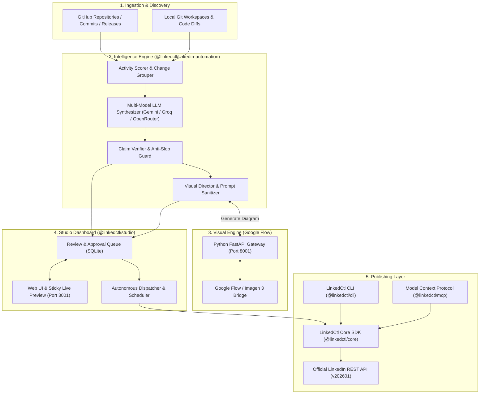

# 🚀 LinkedIn Automation & Studio

<p align="center">
  <strong>The complete developer workspace and autonomous publishing pipeline for LinkedIn</strong>
</p>

<p align="center">
  
  
  
  
  
  
</p>

---

## 📖 Overview

**LinkedIn Automation & Studio** is an enterprise-grade developer platform that unifies an **autonomous multi-agent content pipeline**, an **interactive desktop studio**, a **Model Context Protocol (MCP) server**, and a **scriptable command-line interface (CLI)** for the LinkedIn REST API.

Whether you want to automate verified engineering changelogs from GitHub commits, generate architectural visuals via Google Flow, review drafts inside a Linear-grade web UI, or integrate LinkedIn publishing into AI agents (Claude Desktop, Cursor, Windsurf), this platform provides the complete end-to-end tooling.

---

## ✨ Key Features

- 🎨 **LinkedIn Studio (Web Dashboard)**: Modern Linear/Raycast-inspired dark UI with a **62% editor / 38% sticky live feed preview**, interactive hashtag chips, editor formatting toolbar, AI draft generator, and media management.
- 🤖 **Autonomous Multi-Agent Pipeline**:
    - **Git Activity Scorer**: Mines commits and releases from GitHub repositories.
    - **Claim Verifier**: Cross-checks facts against raw code changes to eliminate AI hallucinations.
    - **Slop Guard**: Penalizes marketing fluff, buzzwords, and AI cliches for high-signal engineering commentary.
- 🖼️ **AI Visual & Diagram Synthesis**: Automated generation of technical diagrams, flowcharts, and editorial graphics via **Google Flow (Imagen 3)** with built-in self-healing prompt safety sanitization and auto-retries.
- 🔌 **Model Context Protocol (MCP)**: Native MCP server exposing 12+ rich tools for AI assistants (Claude Desktop, Claude Code, Cursor, Windsurf, Cline).
- 💻 **Complete Developer CLI**: 25+ scriptable commands for posts, polls, carousels, documents, comments, reactions, organization pages, and analytics.
- 🛡️ **Enterprise Safety & Idempotency**: State tracking via SQLite, duplicate post protection, rate-limit safeguards, and credential encryption.

---

## 🏛️ System Architecture



---

## 🎨 LinkedIn Studio (Web Dashboard)

LinkedCtl includes a local web studio tailored for technical post composition, visual synthesis, and review workflows:

```sh
# Start LinkedIn Studio server (running on http://localhost:3001)
pnpm studio
```

Open [http://localhost:3001](http://localhost:3001) in your browser:

| Workspace View       | Description                                                                                                                                                                                                                          |
| :------------------- | :----------------------------------------------------------------------------------------------------------------------------------------------------------------------------------------------------------------------------------- |
| **Post Composer**    | Dual-column desktop layout (~62% editor, ~38% sticky preview) matching LinkedIn's desktop feed. Includes text formatting, suggested hashtag chips, AI draft assistant, image aspect ratio generator, and drag-and-drop media upload. |
| **GitHub Discovery** | Inspect commits, pull requests, and releases across repositories to extract verified technical claims.                                                                                                                               |
| **Review & Drafts**  | Filterable approval tray (`REVIEW_REQUIRED`, `APPROVED`, `SCHEDULED`, `PUBLISHED`) with live editing and approval controls.                                                                                                          |
| **Queue & History**  | Chronological timeline of upcoming scheduled releases alongside historical published posts with direct feed links.                                                                                                                   |
| **Settings & Logs**  | Automation lookback windows, cadence intervals, worker thresholds, and real-time SSE execution logs.                                                                                                                                 |

---

## ⚡ Quick Start

### Prerequisites

- **[Node.js](https://nodejs.org)** $\ge$ 24
- **[pnpm](https://pnpm.io)** $\ge$ 9
- A **[LinkedIn Developer App](https://www.linkedin.com/developers/apps)** with OAuth 2.0 permissions (`w_member_social`, `openid`, `profile`)

### 1. Installation

```sh
git clone https://github.com/shreeharsh-patil/LinkedIn-Automations.git
cd LinkedIn-Automations
pnpm install
pnpm build
```

### 2. Configure Credentials

Create a `.env` file in the project root or configure your LinkedIn profile:

```sh
# Optional AI synthesis credentials (supports automatic failover)
GEMINI_API_KEY="your-gemini-api-key"
GROQ_API_KEY="your-groq-api-key"
OPENROUTER_API_KEY="your-openrouter-api-key"

# LinkedIn API Version
LINKEDCTL_API_VERSION="202601"
```

Authenticate with your LinkedIn Developer App:

```sh
pnpm --filter linkedctl exec linkedctl auth login --client-id YOUR_CLIENT_ID --client-secret YOUR_CLIENT_SECRET
```

See the [OAuth Setup Guide](docs/oauth-setup.md) for detailed step-by-step instructions.

### 3. Launch Applications

```sh
# Launch the interactive Web Studio
pnpm studio

# Run the CLI
pnpm --filter linkedctl exec linkedctl --help

# Run all test suites
pnpm test:all
```

---

## 🔌 Model Context Protocol (MCP) Integration

LinkedCtl includes a native MCP server (`@linkedctl/mcp`) that enables AI assistants to draft, inspect, and publish to LinkedIn autonomously.

### Client Configuration

<details open>
<summary><b>Claude Desktop</b></summary>

Add to your `claude_desktop_config.json`:

```json
{
    "mcpServers": {
        "linkedctl": {
            "command": "node",
            "args": ["/absolute/path/to/LinkedIn-Automations/packages/mcp/dist/index.js"]
        }
    }
}
```

</details>

<details>
<summary><b>Claude Code</b></summary>

```sh
claude mcp add linkedctl -- node /absolute/path/to/LinkedIn-Automations/packages/mcp/dist/index.js
```

</details>

<details>
<summary><b>Cursor</b></summary>

Add to `.cursor/mcp.json`:

```json
{
    "mcpServers": {
        "linkedctl": {
            "command": "node",
            "args": ["/absolute/path/to/LinkedIn-Automations/packages/mcp/dist/index.js"]
        }
    }
}
```

</details>

<details>
<summary><b>Windsurf</b></summary>

Add to `~/.codeium/windsurf/mcp_config.json`:

```json
{
    "mcpServers": {
        "linkedctl": {
            "command": "node",
            "args": ["/absolute/path/to/LinkedIn-Automations/packages/mcp/dist/index.js"]
        }
    }
}
```

</details>

### Available MCP Tools

| Tool              | Category      | Description                                                                              |
| :---------------- | :------------ | :--------------------------------------------------------------------------------------- |
| `whoami`          | Auth          | Get authenticated member's name, email, and vanity profile URL                           |
| `auth_status`     | Auth          | Inspect active OAuth 2.0 token expiry and scope access                                   |
| `auth_revoke`     | Auth          | Revoke access tokens server-side and purge local profile credentials                     |
| `post_create`     | Posts         | Publish or draft text, single/multi-image, video, document, poll, or article posts       |
| `post_get`        | Posts         | Retrieve a post payload by URN                                                           |
| `post_list`       | Posts         | List authored posts with pagination and organization filters                             |
| `post_update`     | Posts         | Modify commentary text on an existing LinkedIn post                                      |
| `post_delete`     | Posts         | Permanently remove a post by URN                                                         |
| `comment_create`  | Comments      | Post a comment under any publication (supports organization persona)                     |
| `comment_list`    | Comments      | Paginate comments on a post                                                              |
| `reaction_create` | Reactions     | Add reactions (`LIKE`, `PRAISE`, `EMPATHY`, `INTEREST`, `APPRECIATION`, `ENTERTAINMENT`) |
| `reaction_delete` | Reactions     | Remove an active reaction from a post                                                    |
| `org_list`        | Organizations | Enumerate organization pages administered by the user                                    |
| `org_followers`   | Organizations | Fetch live follower counts for an organization                                           |
| `stats_post`      | Analytics     | Query impressions, reach, engagement rate, reactions, and reshares                       |
| `stats_me`        | Analytics     | Aggregate lifetime metrics across all author publications                                |
| `document_upload` | Media         | Upload PDF, DOCX, PPTX presentation decks up to 100 MB                                   |

---

## 💻 CLI Reference

LinkedCtl offers an intuitive, scriptable command-line interface.

```sh
# Shorthand text post
linkedctl post "Excited to share our new open source release!"

# Post with attached diagram and custom visibility
linkedctl post create \
  --text "Architecture breakdown of our high-throughput queue" \
  --image-file ./architecture.png \
  --visibility PUBLIC

# Create an interactive poll
linkedctl post create \
  --text "Which runtime do you deploy Node.js microservices on?" \
  --poll "Primary runtime in 2026?" \
  --option "Node.js (LTS)" \
  --option "Bun" \
  --option "Deno" \
  --poll-duration ONE_WEEK

# Upload a slide deck / document
linkedctl media upload-document ./whitepaper.pdf --title "Systems Whitepaper"

# View lifetime analytics in JSON or table
linkedctl stats me --format table

# Manage multiple accounts with profiles
linkedctl profile create work --access-token YOUR_TOKEN --api-version 202601
linkedctl --profile work post "Hello from my work account!"
```

---

## 📦 Monorepo Packages

| Package                              | Path                                                            | Description                                                                           |
| :----------------------------------- | :-------------------------------------------------------------- | :------------------------------------------------------------------------------------ |
| **`@linkedctl/studio`**              | [`flow-agent-main/`](flow-agent-main)                           | Express web orchestrator, Linear-style Studio UI, and Python Flow image engine bridge |
| **`@linkedctl/linkedin-automation`** | [`packages/linkedin-automation/`](packages/linkedin-automation) | Git commit analysis, LLM post synthesis, claim verification, and prompt safety engine |
| **`@linkedctl/core`**                | [`packages/core/`](packages/core)                               | Low-level LinkedIn REST API client, OAuth2 PKCE handshake, and token storage          |
| **`@linkedctl/cli`**                 | [`packages/cli/`](packages/cli)                                 | CLI commands, argument parsers, formatters, and terminal outputs                      |
| **`@linkedctl/mcp`**                 | [`packages/mcp/`](packages/mcp)                                 | Model Context Protocol server exposing LinkedIn tools to AI assistants                |
| **`@linkedctl/e2e`**                 | [`packages/e2e/`](packages/e2e)                                 | Automated end-to-end integration and lifecycle verification test suite                |
| **`linkedctl`**                      | [`packages/linkedctl/`](packages/linkedctl)                     | Umbrella distribution package combining the CLI and MCP runtime                       |

---

## 🛡️ Security, Privacy & Safety

- **Zero-Credential Exposure**: Access tokens, refresh tokens, and client secrets are never logged to console or stdout.
- **Self-Healing Prompt Safety Sanitizer**: Automatically detects Google Imagen / Flow content safety restrictions (e.g. engineering terms like `kill`, `deadlock`, `exploit`, `poison pill`) and safely reformulates prompts on the fly.
- **Strict Safe-Mode by Default**: In `SAFE` automation mode, all synthesized content requires explicit human-in-the-loop review before queue insertion.
- **File System Validation**: Secure path normalization protects media upload endpoints against path traversal attacks.
- **Destructive Operation Prompts**: Deletion of posts, comments, or authentication profiles mandates interactive confirmation unless explicit `--force` is supplied.

---

## 📄 License

This project is licensed under the [AGPL-3.0 License](LICENSE).

- **Using as a CLI tool or MCP server**: Free to use without copyleft obligations on your content.
- **Modifying or incorporating core libraries into network services**: Requires distribution of derivative source code under AGPL-3.0.

---

<p align="center">
  <sub>Built with ❤️ for software engineers and developer advocates. Not affiliated with or endorsed by LinkedIn Corporation.</sub>
</p>
