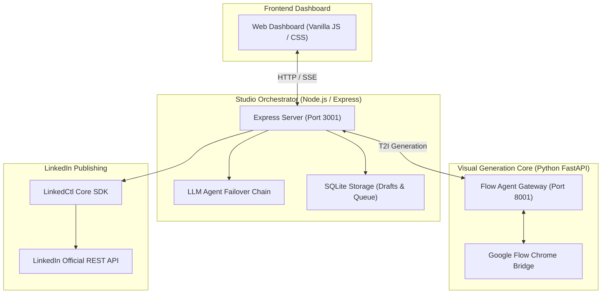

# 🎨 LinkedIn Studio & Flow Visual Agent

### Interactive Web Dashboard, Autonomous Publishing Pipeline & Google Flow Visual Engine

**LinkedIn Studio** is a full-stack, production-grade publishing and AI visual generation platform for LinkedIn. It couples a modern TypeScript Express dashboard with a Python Google Flow image generation bridge, providing real-time feed previews, GitHub commit discovery, multi-model LLM post synthesis, and safe automated dispatch.

## Features

- **Interactive Post Composer**: Compose technical posts with real-time LinkedIn desktop feed simulation.
- **AI Visual Generator**: Generate architectural diagrams and editorial graphics via Google Flow with self-healing prompt safety sanitization.
- **GitHub Commit Discovery**: Extract verified engineering facts and claims from git repositories.
- **Review & Drafts Queue**: Approve, reject, schedule, or edit generated content before publishing.
- **Autonomous Dispatch**: Automated scheduling with safety thresholds and deduplication.

## Quick Start

```sh
# Start LinkedIn Studio server (defaults to port 3001)
pnpm studio

# Open in browser:
http://localhost:3001
```

## Architecture


