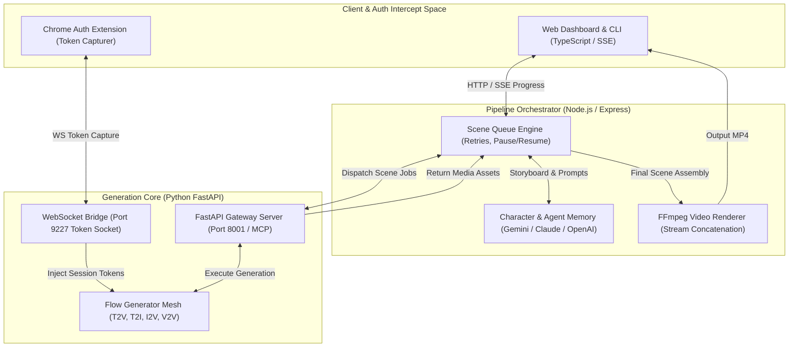
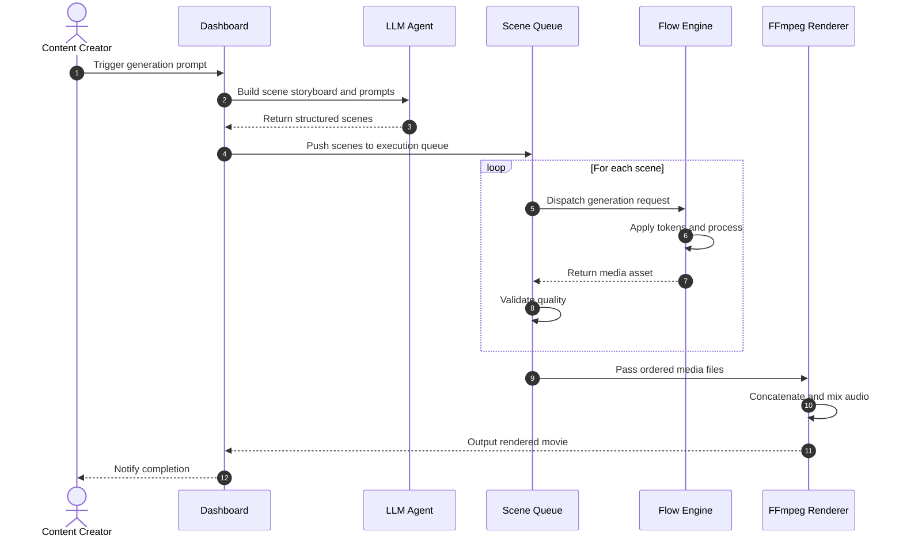

<div align="center">

# 🎬 Flow Automation & Movie Agent

### Enterprise-Grade AI Movie Generation Platform, Multi-Model Pipeline Orchestration & Chrome Auth Bridge

**Flow Automation & Movie Agent** is a full-stack, production-ready AI movie generation platform powered by Google Flow. By coupling a TypeScript Express orchestrator with a Python FastAPI extension backend, the system automates multi-scene video generation (T2V, T2I, I2V, V2V), character consistency management, and FFmpeg video compilation—providing real-time SSE streaming, queue control, and Chrome extension token capturing without workflow interruption.

<p align="center">
  
  
  
  
  
  
  
</p>

<p align="center">
  <a href="https://github.com/shreeharsh-patil/Flow-Automation-And-Movie-Agent/stargazers"></a>
  <a href="https://github.com/shreeharsh-patil/Flow-Automation-And-Movie-Agent/issues"></a>
  <a href="LICENSE"></a>
</p>

</div>

---

## 🏛️ System Architecture & Generation Pipeline

Video generation across multiple generative AI pipelines often struggles with orphan jobs, token expiration, and inconsistent character renders.

This platform resolves these issues through a **Decoupled Orchestration Topology**. The TypeScript Express server manages prompt breakdown, character memory, and scene queuing, while the FastAPI Python engine interfaces with Google Flow (T2V, T2I, I2V, V2V). Authentication tokens are dynamically captured and renewed in real-time via a dedicated Chrome extension bridge over WebSockets.



> [!NOTE]
> **Token Renewal Strategy:** The `flow-extension` captures session authorization vectors directly from active browser tabs and relays them via a local WebSocket connection (Port 9227). This allows long-running rendering queues to continue uninterrupted without manual token refreshes.

---

### 🔄 End-to-End Movie Synthesis Lifecycle

The sequence diagram below displays the step-by-step path from initial prompt expansion to individual scene rendering and final FFmpeg video concatenation:



---

## 🛠️ Production Pipeline Implementation

| Component | Technical Challenge | Our Solution Architecture |
|---|---|---|
| 🔐 Auth Maintenance | Google Flow authentication tokens expire rapidly during long video generation queues. | Implements a background Chrome Extension that captures live tokens and pipes them directly to the Python backend via WebSockets. |
| 🛡️ Media Ingestion | Downloading media assets from dynamic remote sources introduces SSRF and corrupted file risks. | Integrates an isolated downloader with strict SSRF validation, mime-type verification, and media integrity checks. |
| 🎞️ Character Consistency | AI models generate inconsistent character features across sequential movie scenes. | Tracks character attributes using dedicated LLM memory agents, injecting structural prompts across scene generation calls. |
| ⚡ Task Reliability | Network drops or generation timeouts cause orphan jobs and pipeline crashes. | Uses an exponential backoff queue with pause/resume support, automatic retry bounds, and orphan process cleanup handlers. |

---

## 🚀 Deployment & Local Initialization

### Prerequisites

- **Node.js Environment:** Node.js >= 18.x
- **Python Runtime:** Python >= 3.11 with `uv` package manager installed
- **System Binaries:** FFmpeg installed globally and accessible via `$PATH`

### Environment Setup Sequences

#### 1. Repository Instantiation & Dependency Installation

```bash
# Clone the repository
git clone https://github.com/shreeharsh-patil/Flow-Automation-And-Movie-Agent.git
cd Flow-Automation-And-Movie-Agent

# Install Node.js orchestrator dependencies
npm install

# Install Python backend dependencies using uv
cd flow-agent
uv sync --extra test
cd ..
```

#### 2. Environment Variables Allocation

Create a `.env` file in the project root based on the configuration parameters below:

```ini
GEMINI_API_KEY="your_google_gemini_api_key_here"
LLM_PROVIDER="gemini"                   # Options: gemini, claude, openrouter, openai
LLM_MODEL="gemini-1.5-flash"
FLOW_AGENT_API_URL="http://127.0.0.1:8001"
PORT=3000
OUTPUT_FOLDER="./projects"
```

### Running the Platform

#### Step 1: Start System Servers

```bash
# Terminal 1: Python FastAPI Engine (Port 8001)
cd flow-agent
uv run uvicorn flow_server.app:app --host 127.0.0.1 --port 8001

# Terminal 2: Express Orchestrator & Dashboard (Port 3000)
npm start
```

#### Step 2: Load Chrome Extension

1. Open Chrome and navigate to `chrome://extensions`.
2. Enable **Developer mode** in the top-right corner.
3. Click **Load unpacked** and select the `flow-extension/` directory from the repository.
4. The extension will automatically establish a connection to `ws://127.0.0.1:9227` to pass authorization tokens to the backend.

---

## 💻 CLI Operations & Testing

### CLI Movie Generation Commands

```bash
# Generate a complete movie from a text prompt
npm run cli generate --prompt "Cyberpunk detective thriller" --duration 60 --title "Neon Shadows"

# List saved projects and status logs
npm run cli list

# Re-render FFmpeg output for a specific project
npm run cli render <project-id>
```

### Test Suite Execution

```bash
# Run Python backend unit and integration test suite (50 tests)
cd flow-agent
uv run pytest

# Execute TypeScript type validation across frontend and orchestrator
cd ..
npx tsc --noEmit
```

---

## 📁 Repository Directory Architecture

```
Flow-Automation-And-Movie-Agent/
├─ flow-agent/                      (Python FastAPI AI Generation Service)
│  ├─ flow_server/                  (FastAPI routes, MCP server, and WebSocket handlers)
│  ├─ flow_engine/                  (Extension bridge, generators: T2V, T2I, I2V, V2V)
│  └─ tests/                        (Pytest suite covering core engine functionality)
├─ src/                             (TypeScript Express Orchestrator Core)
│  ├─ agents/                       (LLM character memory & prompt breakdown agents)
│  ├─ download/                     (Media downloader with SSRF protection & quality checks)
│  ├─ flow/                         (Flow client with backoff & orphan process cleanup)
│  ├─ projects/                     (Project manager, storyboard, & state controllers)
│  ├─ queue/                        (Scene generation queue with pause/resume support)
│  ├─ renderer/                     (FFmpeg video concatenation module)
│  ├─ cli.ts                        (Command line interface entry point)
│  └─ server.ts                     (Express server application with SSE streaming)
├─ flow-extension/                  (Chrome Extension for capturing Google Flow session tokens)
├─ package.json                     (TypeScript dependencies and project scripts)
└─ README.md                        (Unified platform documentation)
```

---

## ⚖️ Legal Guidelines & License

> [!WARNING]
> This platform is distributed under the terms of the MIT License. It is an independent engineering project built for multi-modal generation pipeline research, automation testing, and software portfolio evaluations. Users are responsible for managing their API keys, adhering to Google Flow usage guidelines, and ensuring content compliance.

---

## 👤 Project Author

**Developed and Maintained by Shreeharsh Patil.**

Feel free to contact me or submit issues via:
- **Email:** shreeharsh.dev@gmail.com
- **GitHub Profile:** [github.com/shreeharsh-patil](https://github.com/shreeharsh-patil)
